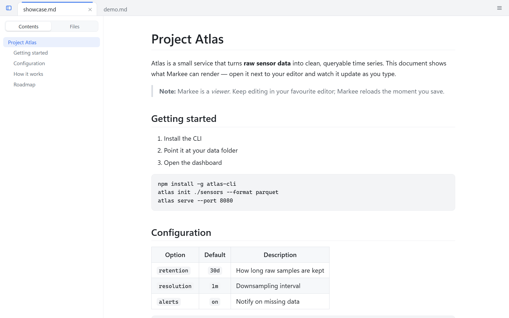
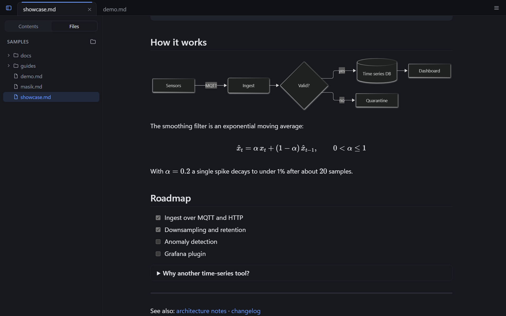
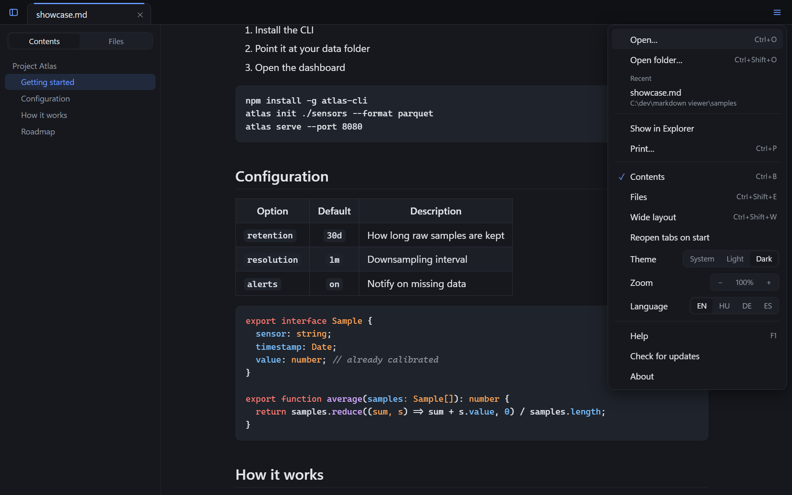
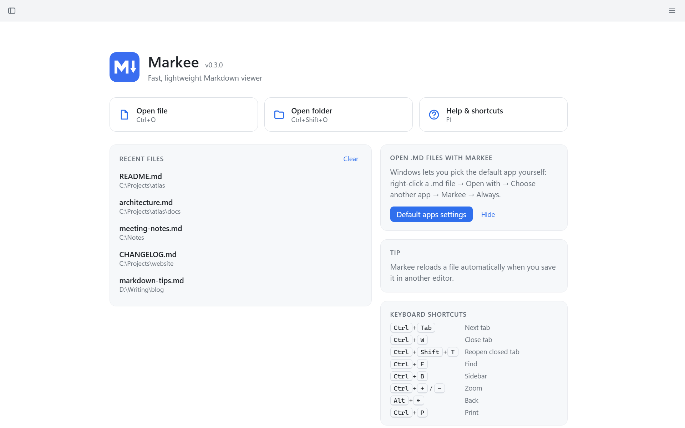

<p align="center">
  
</p>

<h1 align="center">Markee</h1>

<p align="center">
  <b>A fast, lightweight Markdown viewer for Windows.</b><br>
  Double-click a <code>.md</code> file and read it — with tabs, a table of contents, search, math, diagrams and live reload.
</p>

<p align="center">
  <a href="https://github.com/JMarty/markee/releases/latest"></a>
  <a href="https://github.com/JMarty/markee/actions/workflows/ci.yml"></a>
  <a href="LICENSE"></a>
  
</p>

<p align="center">
  <a href="#download">Download</a> ·
  <a href="#features">Features</a> ·
  <a href="#keyboard-shortcuts">Shortcuts</a> ·
  <a href="#building-from-source">Build</a> ·
  <a href="README.hu.md">Magyar</a>
</p>



## Why?

Markdown is readable as plain text, but it's meant to be rendered. Most tools that render it are either heavy (launching an IDE to read a README) or editors first and viewers second. Markee does one thing: **open a Markdown file and show it beautifully — instantly.**

- 🪶 **Small** – a ~4.5 MB installer, built on [Tauri](https://tauri.app) and the WebView2 that ships with Windows
- ⚡ **Fast** – native startup; heavy libraries (Mermaid, KaTeX) load only when a document needs them
- 🎯 **Focused** – no editor, no account, no cloud, no telemetry

## Download

Grab the latest `Markee_x.y.z_x64-setup.exe` from the [**Releases**](https://github.com/JMarty/markee/releases/latest) page and run it. No admin rights needed — it installs for the current user. After that, Markee keeps itself up to date.

**Make it your default viewer:** Windows doesn't let apps do this themselves, so do it once: right-click a `.md` file → *Open with* → *Choose another app* → **Markee** → *Always*.

> The installer isn't code-signed yet, so Windows SmartScreen may warn you the first time ("More info" → "Run anyway").

## Features

**Reading**
- **Tabs** – open many files in one window; files opened from Explorer join the running window as new tabs
- **Reopen tabs on start** – like Notepad, Markee remembers your open tabs and scroll positions (can be turned off)
- **Table of contents** sidebar that highlights the current section
- **Folder view** – browse a whole documentation folder from the sidebar
- **Find in page** (`Ctrl+F`) with match counter
- **Link navigation** – relative `.md` links open inside Markee with back/forward history; external links open in your browser
- **Live reload** – save the file in any editor and Markee updates instantly, keeping your scroll position

**Rendering**
- **GitHub-flavoured Markdown** – tables, task lists, strikethrough, autolinks, `<details>`
- **Syntax highlighting** for 30+ languages, with a copy button on every code block
- **Math** – `$inline$` and `$$display$$` formulas via [KaTeX](https://katex.org)
- **Diagrams** – ` ```mermaid ` blocks via [Mermaid](https://mermaid.js.org), matching the current theme
- **Relative images** resolved from the document's folder

**Everything else**
- **Light / dark theme** (or follow Windows), zoom, wide layout
- **Print / PDF** (`Ctrl+P`, then "Microsoft Print to PDF") with a clean print layout
- **Languages**: English, Magyar, Deutsch, Español — follows your Windows language
- **Informative start screen** with recent files, tips and shortcuts
- **Automatic updates** – signed update packages from GitHub Releases
- **Safe by default** – embedded HTML is sanitised with [DOMPurify](https://github.com/cure53/DOMPurify); scripts never run

| Dark theme, diagrams, math and folder view | Menu |
|---|---|
|  |  |



## Keyboard shortcuts

| Shortcut | Action |
|---|---|
| `Ctrl+O` / `Ctrl+Shift+O` | Open file / folder |
| `Ctrl+W` / middle-click | Close tab |
| `Ctrl+Shift+T` | Reopen closed tab |
| `Ctrl+Tab` / `Ctrl+Shift+Tab` | Next / previous tab |
| `Ctrl+1` … `Ctrl+9` | Jump to tab |
| `Ctrl+F`, `F3` / `Shift+F3` | Find, next / previous match |
| `Ctrl+B` | Toggle sidebar |
| `Ctrl+Shift+E` | Files panel |
| `Ctrl+P` | Print |
| `Ctrl++` / `Ctrl+-` / `Ctrl+0` / `Ctrl+wheel` | Zoom |
| `Ctrl+Shift+W` | Toggle wide layout |
| `Ctrl+Shift+L` | Theme: system → light → dark |
| `Alt+←` / `Alt+→` | Back / forward |
| `Alt` | Menu |
| `F1` | Help |
| `F5` | Reload |
| `Ctrl+click` a link | Open in a new tab |

## Building from source

Requirements: [Node.js](https://nodejs.org/) 20+, [Rust](https://rustup.rs/) (stable), Visual Studio Build Tools with the *Desktop development with C++* workload, and the WebView2 Runtime (preinstalled on Windows 10/11).

```bash
npm install
npm run tauri dev      # development mode with hot reload
npm run tauri build    # release build + installer in src-tauri/target/release/bundle/nsis/
```

Release builds also sign the update package, which needs `TAURI_SIGNING_PRIVATE_KEY` (and `TAURI_SIGNING_PRIVATE_KEY_PASSWORD`). For your own builds, generate a key with `npx tauri signer generate`, or set `bundle.createUpdaterArtifacts` to `false`.

The UI also runs in a normal browser with a mocked backend: `npm run dev`, then open <http://localhost:1420/dev/preview.html> (see the comment at the top of that file for options).

### Project layout

```
src/
  main.ts       tabs, navigation, menu, sidebar, session, shortcuts, live reload
  render.ts     Markdown → HTML (markdown-it, highlight.js, DOMPurify), paths
  extras.ts     math (KaTeX) and diagrams (Mermaid), lazy-loaded
  folder.ts     folder view
  find.ts       find in page (CSS Custom Highlight API – never touches the DOM)
  i18n.ts       UI translations
  help/*.md     built-in help, one file per language
  updater.ts    automatic updates
  styles.css    themes, typography, print layout
src-tauri/
  src/lib.rs    file reading, folder listing, file watching, single instance
  windows/hooks.nsh   installer hook for the "Open with" list
.github/workflows/    CI and automated releases
```

### Releasing

1. Bump the version in `package.json`, `src-tauri/Cargo.toml` and `src-tauri/tauri.conf.json`
2. Commit, tag and push: `git tag v0.3.0 && git push origin main v0.3.0`
3. The [release workflow](.github/workflows/release.yml) builds, signs and publishes the installer; installed copies pick it up via `latest.json`

### Adding a language

Add a dictionary to [`src/i18n.ts`](src/i18n.ts) and a help file to [`src/help/`](src/help/). Pull requests are very welcome!

## Contributing

Bug reports, ideas and pull requests are welcome — please [open an issue](https://github.com/JMarty/markee/issues) first for larger changes.

## About this project

Markee is a vibe-coded project: it was built in conversation with [Claude Code](https://claude.com/claude-code), with a human deciding what to build and reviewing the result. The code is fully open — read it, fork it, improve it.

## License

[MIT](LICENSE) © JMarty
