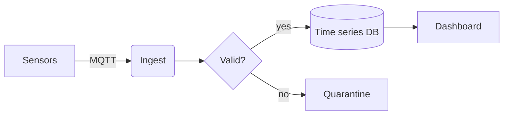

# Project Atlas

Atlas is a small service that turns **raw sensor data** into clean, queryable time series. This document shows what Markee can render — open it next to your editor and watch it update as you type.

> **Note:** Markee is a *viewer*. Keep editing in your favourite editor; Markee reloads the moment you save.

## Getting started

1. Install the CLI
2. Point it at your data folder
3. Open the dashboard

```bash
npm install -g atlas-cli
atlas init ./sensors --format parquet
atlas serve --port 8080
```

## Configuration

| Option | Default | Description |
|---|:---:|---|
| `retention` | `30d` | How long raw samples are kept |
| `resolution` | `1m` | Downsampling interval |
| `alerts` | `on` | Notify on missing data |

```typescript
export interface Sample {
  sensor: string;
  timestamp: Date;
  value: number; // already calibrated
}

export function average(samples: Sample[]): number {
  return samples.reduce((sum, s) => sum + s.value, 0) / samples.length;
}
```

## How it works



The smoothing filter is an exponential moving average:

$$
\hat{x}_t = \alpha \, x_t + (1 - \alpha)\, \hat{x}_{t-1}, \qquad 0 < \alpha \le 1
$$

With $\alpha = 0.2$ a single spike decays to under 1% after about $20$ samples.

## Roadmap

- [x] Ingest over MQTT and HTTP
- [x] Downsampling and retention
- [ ] Anomaly detection
- [ ] Grafana plugin

<details>
<summary>Why another time-series tool?</summary>

Because most of them are built for servers, not for a shoebox full of sensors.

</details>

---

See also: [architecture notes](demo.md) · [changelog](masik.md)
