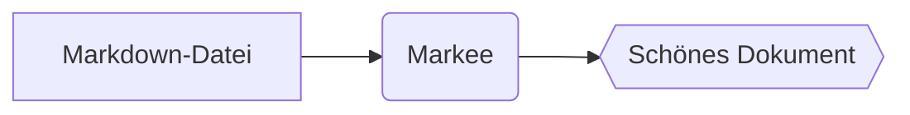

# Markee-Hilfe

Markee ist ein schneller, einfacher Markdown-**Viewer**. Er öffnet `.md`-Dateien und zeigt sie schön an – bearbeite sie in deinem Lieblingseditor, Markee meldet sich, wenn sich die Datei ändert – oder lädt sie automatisch neu, wenn du das einschaltest.

## Dateien öffnen

- **Doppelklick** auf eine `.md`-Datei (wenn Markee der Standard-Viewer ist – siehe unten)
- **Strg+O** oder das Menü (☰) → *Öffnen…*
- Datei auf das Fenster **ziehen**
- **Ordner öffnen** (*Strg+Umschalt+O*): alle Markdown-Dateien eines Ordners im Bereich *Dateien* links durchsuchen
- **Zuletzt geöffnete Dateien** findest du auf dem Startbildschirm und im Menü

Läuft Markee bereits, erscheint eine neu geöffnete Datei in einem **neuen Tab** desselben Fensters.

### Markee als Standard-Viewer festlegen

Windows erlaubt Apps nicht, sich selbst als Standard festzulegen. Einmalig so:

1. Rechtsklick auf eine `.md`-Datei → **Öffnen mit** → **Andere App auswählen**
2. **Markee** auswählen
3. Auf **Immer** klicken

## Tabs

| Aktion | Tastenkürzel |
|---|---|
| Nächster / vorheriger Tab | `Strg+Tab` / `Strg+Umschalt+Tab` |
| Zu Tab 1–8 / zum letzten Tab | `Strg+1` … `Strg+8` / `Strg+9` |
| Tab schließen | `Strg+W` oder Mittelklick |
| Geschlossenen Tab wiederherstellen | `Strg+Umschalt+T` |

## Lesen und Navigation

| Aktion | Tastenkürzel |
|---|---|
| Im Dokument suchen | `Strg+F`, dann `Enter` / `Umschalt+Enter` oder `F3` / `Umschalt+F3` |
| Seitenleiste (Inhalt) | `Strg+B` |
| Bereich „Dateien“ | `Strg+Umschalt+E` |
| Zurück / vor nach Links | `Alt+←` / `Alt+→` oder die Maus-Seitentasten |
| Link in neuem Tab öffnen | `Strg+Klick` oder Mittelklick |
| Anfang / Ende des Dokuments | `Pos1` / `Ende` |
| Neu laden | `F5` |
| Drucken | `Strg+P` |
| Menü | `Alt` |
| Hilfe | `F1` |

## Darstellung

| Aktion | Tastenkürzel |
|---|---|
| Vergrößern / verkleinern / zurücksetzen | `Strg++` / `Strg+−` / `Strg+0` oder `Strg+Mausrad` |
| Breite Ansicht | `Strg+Umschalt+W` |
| Design (System → Hell → Dunkel) | `Strg+Umschalt+L` |

## Was wird angezeigt?

Markee versteht **GitHub-Flavored Markdown**: Überschriften, Listen, ~~Durchgestrichenes~~, Tabellen, Aufgabenlisten, Code mit Syntaxhervorhebung, Bilder, Links und `<details>`-Blöcke.

- [x] Aufgabenlisten
- [x] Syntaxhervorhebung für über 30 Sprachen
- [x] Formeln und Diagramme

### Formeln (KaTeX)

Im Text zwischen Dollarzeichen: $E = mc^2$, in einer eigenen Zeile mit doppelten Dollarzeichen:

$$
\int_0^\infty e^{-x^2}\,dx = \frac{\sqrt{\pi}}{2}
$$

### Diagramme (Mermaid)

````markdown

````


## Wenn sich eine Datei ändert

Ändert sich eine geöffnete Datei auf der Festplatte (z. B. weil du sie in einem Editor speicherst), zeigt Markee oben im Dokument einen Hinweis und einen blauen Punkt neben dem Tab-Namen. Mit **Neu laden** (oder `F5`) aktualisierst du sie.

Soll das automatisch passieren: Menü → *Bei Änderungen automatisch neu laden*, oder klicke im Hinweis auf **Immer automatisch neu laden**. Die Scrollposition bleibt erhalten. Wurde die Datei gelöscht oder verschoben, zeigt Markee das ebenfalls an.

## Tabs wiederherstellen

Wie der Editor von Windows merkt sich Markee die geöffneten Tabs und Scrollpositionen und stellt sie beim nächsten Start wieder her. Abschalten: Menü → *Tabs beim Start wiederherstellen*.

## Sprache

Markee folgt der Windows-Sprache (Englisch, Ungarisch, Deutsch, Spanisch). Ändern: Menü → *Sprache*.

## Updates

Beim Start prüft Markee still, ob es eine neuere Version gibt. Falls ja, erscheint unten rechts ein Hinweis – ein Klick genügt. Manuell: Menü → *Nach Updates suchen*.

## Sicherheit

Markee bereinigt in Dokumente eingebettetes HTML: Skripte und gefährliche Elemente werden nie ausgeführt, du kannst also Dateien aus beliebigen Quellen gefahrlos öffnen.

---

Fehler gefunden oder eine Idee? Schreib uns auf [GitHub](https://github.com/JMarty/markee/issues).
