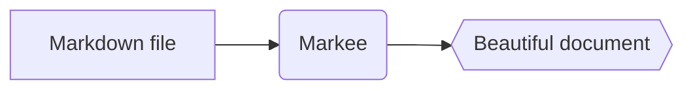

# Markee help

Markee is a fast, simple Markdown **viewer**. It opens `.md` files and shows them nicely – edit them in your favourite editor, and Markee reloads automatically when you save.

## Opening files

- **Double-click** a `.md` file (once Markee is the default viewer – see below)
- **Ctrl+O** or the menu (☰) → *Open…*
- **Drag** the file onto the window
- **Open folder** (*Ctrl+Shift+O*): browse every Markdown file of a folder in the *Files* panel on the left
- **Recent files** are on the start screen and in the menu

If Markee is already running, a newly opened file appears in a **new tab** of the same window.

### Making Markee the default viewer

Windows doesn't let apps set themselves as default, so do this once:

1. Right-click a `.md` file → **Open with** → **Choose another app**
2. Pick **Markee**
3. Click **Always**

## Tabs

| Action | Shortcut |
|---|---|
| Next / previous tab | `Ctrl+Tab` / `Ctrl+Shift+Tab` |
| Go to tab 1–8 / last tab | `Ctrl+1` … `Ctrl+8` / `Ctrl+9` |
| Close tab | `Ctrl+W` or middle-click |
| Reopen closed tab | `Ctrl+Shift+T` |

## Reading and navigation

| Action | Shortcut |
|---|---|
| Find in document | `Ctrl+F`, then `Enter` / `Shift+Enter` or `F3` / `Shift+F3` |
| Sidebar (contents) | `Ctrl+B` |
| Files panel | `Ctrl+Shift+E` |
| Back / forward after following links | `Alt+←` / `Alt+→` or the mouse side buttons |
| Open link in a new tab | `Ctrl+click` or middle-click |
| Top / bottom of document | `Home` / `End` |
| Reload | `F5` |
| Print | `Ctrl+P` |
| Menu | `Alt` |
| Help | `F1` |

## Appearance

| Action | Shortcut |
|---|---|
| Zoom in / out / reset | `Ctrl++` / `Ctrl+−` / `Ctrl+0`, or `Ctrl+wheel` |
| Wide layout | `Ctrl+Shift+W` |
| Theme (system → light → dark) | `Ctrl+Shift+L` |

## What can it display?

Markee understands **GitHub-flavoured Markdown**: headings, lists, ~~strikethrough~~, tables, task lists, syntax-highlighted code, images, links and `<details>` blocks.

- [x] Task lists
- [x] Syntax highlighting for 30+ languages
- [x] Formulas and diagrams

### Formulas (KaTeX)

Inline between dollar signs: $E = mc^2$, on their own line with double dollars:

$$
\int_0^\infty e^{-x^2}\,dx = \frac{\sqrt{\pi}}{2}
$$

### Diagrams (Mermaid)

````markdown

````


## Reopening tabs

Like Notepad, Markee remembers your open tabs and scroll positions and restores them the next time you start it. You can turn this off: menu → *Reopen tabs on start*.

## Language

Markee follows your Windows language (English, Hungarian, German, Spanish). To change it: menu → *Language*.

## Updates

On start, Markee quietly checks for a newer version. If there is one, it tells you in the bottom-right corner – one click to update. Manually: menu → *Check for updates*.

## Security

Markee sanitises HTML embedded in documents: scripts and dangerous elements never run, so you can safely open files from anyone.

---

Found a bug or have an idea? Tell us on [GitHub](https://github.com/JMarty/markee/issues).
