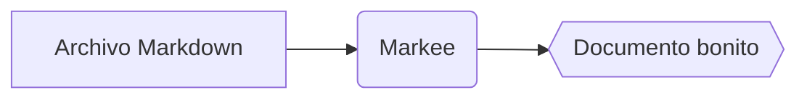

# Ayuda de Markee

Markee es un **visor** de Markdown rápido y sencillo. Abre archivos `.md` y los muestra con buen aspecto: edítalos en tu editor favorito y Markee se recargará solo al guardar.

## Abrir archivos

- **Doble clic** en un archivo `.md` (cuando Markee sea el visor predeterminado; ver abajo)
- **Ctrl+O** o el menú (☰) → *Abrir…*
- **Arrastra** el archivo a la ventana
- **Abrir carpeta** (*Ctrl+Mayús+O*): explora todos los archivos Markdown de una carpeta en el panel *Archivos* de la izquierda
- Los **archivos recientes** están en la pantalla de inicio y en el menú

Si Markee ya está abierto, el archivo nuevo aparece en una **pestaña nueva** de la misma ventana.

### Establecer Markee como visor predeterminado

Windows no permite que una aplicación se establezca a sí misma como predeterminada, así que hazlo una vez:

1. Clic derecho en un archivo `.md` → **Abrir con** → **Elegir otra aplicación**
2. Selecciona **Markee**
3. Haz clic en **Siempre**

## Pestañas

| Acción | Atajo |
|---|---|
| Pestaña siguiente / anterior | `Ctrl+Tab` / `Ctrl+Mayús+Tab` |
| Ir a la pestaña 1–8 / a la última | `Ctrl+1` … `Ctrl+8` / `Ctrl+9` |
| Cerrar pestaña | `Ctrl+W` o clic central |
| Reabrir pestaña cerrada | `Ctrl+Mayús+T` |

## Lectura y navegación

| Acción | Atajo |
|---|---|
| Buscar en el documento | `Ctrl+F`, luego `Enter` / `Mayús+Enter` o `F3` / `Mayús+F3` |
| Barra lateral (índice) | `Ctrl+B` |
| Panel de archivos | `Ctrl+Mayús+E` |
| Atrás / adelante tras seguir enlaces | `Alt+←` / `Alt+→` o los botones laterales del ratón |
| Abrir enlace en una pestaña nueva | `Ctrl+clic` o clic central |
| Inicio / final del documento | `Inicio` / `Fin` |
| Recargar | `F5` |
| Imprimir | `Ctrl+P` |
| Menú | `Alt` |
| Ayuda | `F1` |

## Apariencia

| Acción | Atajo |
|---|---|
| Ampliar / reducir / restablecer | `Ctrl++` / `Ctrl+−` / `Ctrl+0`, o `Ctrl+rueda` |
| Vista ancha | `Ctrl+Mayús+W` |
| Tema (sistema → claro → oscuro) | `Ctrl+Mayús+L` |

## ¿Qué puede mostrar?

Markee entiende **Markdown al estilo de GitHub**: encabezados, listas, ~~tachado~~, tablas, listas de tareas, código con resaltado de sintaxis, imágenes, enlaces y bloques `<details>`.

- [x] Listas de tareas
- [x] Resaltado de sintaxis para más de 30 lenguajes
- [x] Fórmulas y diagramas

### Fórmulas (KaTeX)

En línea entre signos de dólar: $E = mc^2$; en su propia línea con doble dólar:

$$
\int_0^\infty e^{-x^2}\,dx = \frac{\sqrt{\pi}}{2}
$$

### Diagramas (Mermaid)

````markdown

````


## Restaurar pestañas

Como el Bloc de notas, Markee recuerda las pestañas abiertas y la posición de desplazamiento, y las restaura la próxima vez que lo inicies. Se puede desactivar: menú → *Restaurar pestañas al iniciar*.

## Idioma

Markee usa el idioma de Windows (inglés, húngaro, alemán, español). Para cambiarlo: menú → *Idioma*.

## Actualizaciones

Al iniciarse, Markee comprueba en silencio si hay una versión nueva. Si la hay, te avisa en la esquina inferior derecha: un clic y listo. Manualmente: menú → *Buscar actualizaciones*.

## Seguridad

Markee depura el HTML incrustado en los documentos: los scripts y elementos peligrosos nunca se ejecutan, así que puedes abrir archivos de cualquier origen sin riesgo.

---

¿Has encontrado un error o tienes una idea? Cuéntanoslo en [GitHub](https://github.com/JMarty/markee/issues).
