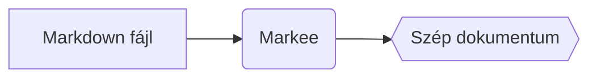

# Markee súgó

A Markee gyors, egyszerű Markdown-**nézegető**. Megnyitja és szépen megmutatja a `.md` fájlokat – szerkeszteni a kedvenc szövegszerkesztődben tudsz, a Markee pedig szól, ha a fájl megváltozik – vagy magától újratölti, ha bekapcsolod.

## Fájlok megnyitása

- **Dupla kattintás** egy `.md` fájlon (ha a Markee az alapértelmezett nézegető – lásd lent)
- **Ctrl+O** vagy a menü (☰) → *Megnyitás…*
- **Húzd rá** a fájlt az ablakra
- **Mappa megnyitása** (*Ctrl+Shift+O*): a bal oldali *Fájlok* panelen böngészheted egy mappa összes Markdown fájlját
- A kezdőképernyőn és a menüben a **legutóbbi fájlok** is elérhetők

Ha a Markee már fut, az újonnan megnyitott fájl **új tabban** jelenik meg ugyanabban az ablakban.

### Beállítás alapértelmezett nézegetőnek

A Windows nem engedi, hogy egy program magát állítsa be, ezért ezt egyszer kézzel kell:

1. Jobb klikk egy `.md` fájlon → **Társítás** → **Másik alkalmazás választása**
2. Válaszd a **Markee**-t
3. Kattints a **Mindig** gombra

## Tabok

| Művelet | Billentyű |
|---|---|
| Következő / előző tab | `Ctrl+Tab` / `Ctrl+Shift+Tab` |
| Ugrás az 1–8. tabra / az utolsóra | `Ctrl+1` … `Ctrl+8` / `Ctrl+9` |
| Tab bezárása | `Ctrl+W` vagy középső kattintás |
| Bezárt tab visszaállítása | `Ctrl+Shift+T` |

## Olvasás és navigáció

| Művelet | Billentyű |
|---|---|
| Keresés a dokumentumban | `Ctrl+F`, majd `Enter` / `Shift+Enter` vagy `F3` / `Shift+F3` |
| Oldalsáv (tartalomjegyzék) | `Ctrl+B` |
| Fájlok panel | `Ctrl+Shift+E` |
| Vissza / előre linkek után | `Alt+←` / `Alt+→` vagy az egér oldalsó gombjai |
| Link megnyitása új tabban | `Ctrl+kattintás` vagy középső kattintás |
| Dokumentum eleje / vége | `Home` / `End` |
| Újratöltés | `F5` |
| Nyomtatás | `Ctrl+P` |
| Menü | `Alt` |
| Súgó | `F1` |

## Megjelenés

| Művelet | Billentyű |
|---|---|
| Nagyítás / kicsinyítés / alaphelyzet | `Ctrl++` / `Ctrl+−` / `Ctrl+0`, vagy `Ctrl+görgő` |
| Széles nézet | `Ctrl+Shift+W` |
| Téma (rendszer → világos → sötét) | `Ctrl+Shift+L` |

## Mit tud megjeleníteni?

A Markee a **GitHub-stílusú Markdownt** ismeri: címsorok, listák, ~~áthúzás~~, táblázatok, feladatlisták, kódblokkok színezéssel, képek, linkek, `<details>` blokkok.

- [x] Feladatlisták
- [x] Kódszínezés több mint 30 nyelven
- [x] Képletek és diagramok

### Képletek (KaTeX)

Soron belül dollárjelek között: $E = mc^2$, külön sorban dupla dollárjellel:

$$
\int_0^\infty e^{-x^2}\,dx = \frac{\sqrt{\pi}}{2}
$$

### Diagramok (Mermaid)

````markdown

````


## Ha a fájl megváltozik

Ha egy nyitott fájl megváltozik a lemezen (pl. elmented egy szerkesztőben), a Markee a dokumentum tetején szól, és a tab neve mellett egy kék pötty jelenik meg. Az **Újratöltés** gombbal (vagy `F5`-tel) frissítheted.

Ha azt szeretnéd, hogy magától frissüljön: menü → *Automatikus újratöltés változáskor*, vagy kattints az üzenetben a **Mindig automatikusan** gombra. A görgetési pozíció újratöltéskor megmarad. Ha a fájlt törölték vagy áthelyezték, azt is jelzi.

## Tabok visszaállítása

A Markee – a Jegyzettömbhöz hasonlóan – megjegyzi a nyitott tabokat és a görgetési pozíciót, és a következő indításkor visszaállítja őket. Kikapcsolható: menü → *Tabok visszaállítása induláskor*.

## Nyelv

A Markee a Windows nyelvét követi (magyar, angol, német, spanyol). Átállítás: menü → *Nyelv*.

## Frissítések

A Markee induláskor csendben megnézi, van-e újabb verzió. Ha van, a jobb alsó sarokban szól – egy kattintással frissíthetsz. Kézzel: menü → *Frissítések keresése*.

## Biztonság

A dokumentumokba ágyazott HTML-t a Markee szűri: szkriptek és veszélyes elemek nem futnak le, így idegen fájlokat is nyugodtan megnyithatsz.

---

Hibát találtál vagy ötleted van? Írd meg a [GitHubon](https://github.com/JMarty/markee/issues).
